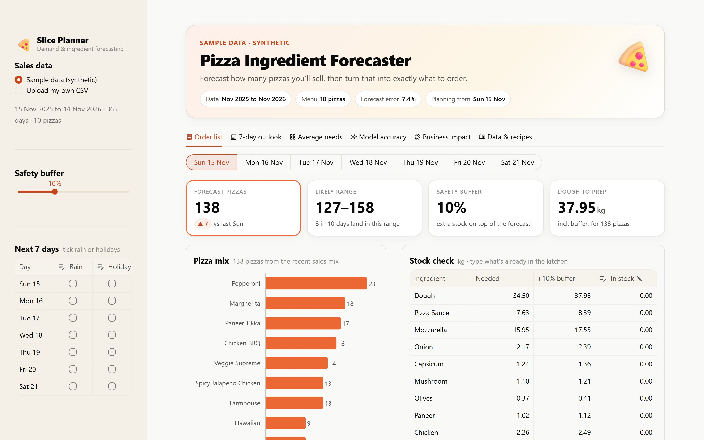
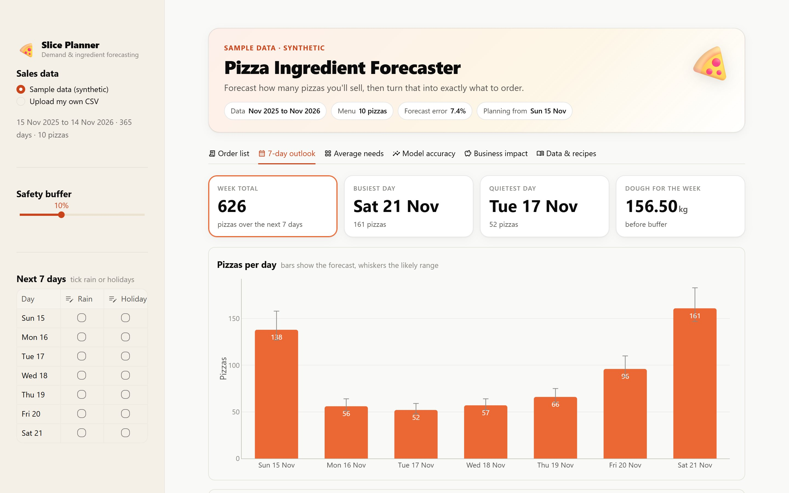
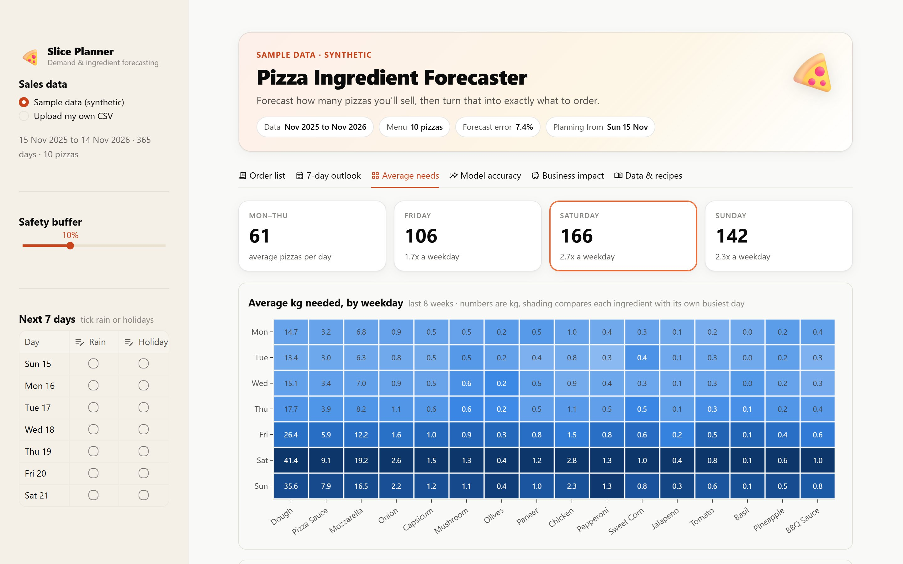
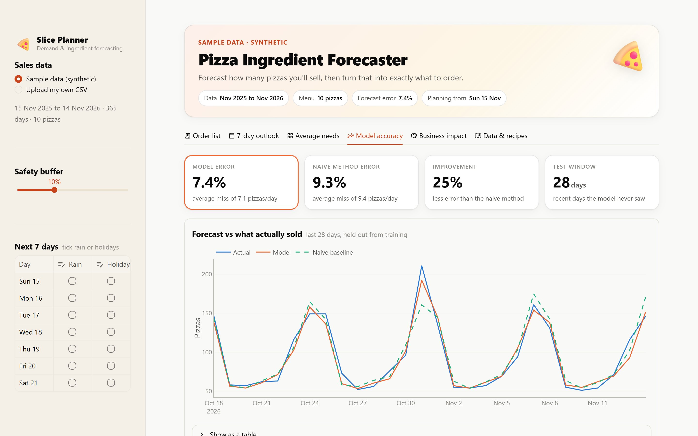
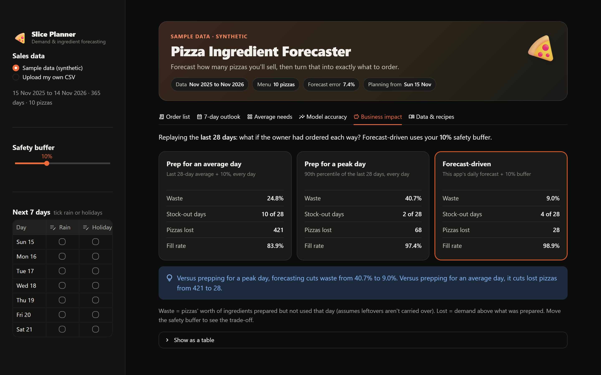

# Pizza Ingredient Forecaster

A demand-forecasting and inventory-planning app for a small pizzeria. It predicts how many pizzas will sell
over the next 7 days, splits that across the 10 menu items, and converts it into an ingredient order list.

**Problem:** weekends sell about 2.5x more than Mon-Wed. Ordering the same amount every day either
wastes food on quiet days or runs out on busy ones.



<table>
  <tr>
    <td width="50%"><br><sub><b>7-day outlook</b>: pizzas per day with likely ranges, and ingredients per day</sub></td>
    <td width="50%"><br><sub><b>Average needs</b>: the weekend rush for every ingredient</sub></td>
  </tr>
  <tr>
    <td><br><sub><b>Model accuracy</b>: tested on 28 days the model never saw</sub></td>
    <td><br><sub><b>Business impact</b> (dark mode): waste and stock-outs for three ordering methods</sub></td>
  </tr>
</table>

Light and dark mode follow your system setting. All screenshots live in [`docs/screens`](docs/screens) and are
regenerated with `python scripts/screenshots.py` while the app is running.

**▶ Try the live app:** https://slice-planner-eosin.vercel.app/app/
The full Streamlit app runs in your browser with [stlite](https://github.com/whitphx/stlite) (Python compiled to
WebAssembly), so there's no server and nothing you upload leaves your machine. The first visit downloads Python
and takes a little while; later visits are faster.

**Showcase page:** https://slice-planner-eosin.vercel.app (a scroll-animated tour of the project, built from
[`docs/index.html`](docs/index.html)). Also on GitHub Pages: https://vaishnav1906.github.io/pizza-ingredient-forecaster/

After changing the app, run `python scripts/build_web.py` to refresh the browser copy in `docs/app/src`, then
redeploy (`vercel deploy --prod` from `docs/`). A test fails if the copy is out of date.

## What it does
- Forecasts daily pizza demand (Gradient Boosting) using weekday, month, holidays, rain and recent sales lags
- Splits the forecast by pizza variety using the recent weekday/weekend sales mix
- Multiplies by editable recipes to give ingredient quantities, adds a safety buffer, subtracts current stock
- Shows average ingredient needs for weekdays vs Fri/Sat/Sun
- Backtests against a naive baseline and replays the last 28 days to estimate waste and stock-outs

## Results on the sample data (28-day holdout)
| Method | MAE (pizzas/day) | MAPE |
|---|---|---|
| Naive baseline (same weekday, last 4 weeks) | 9.4 | 9.3% |
| Gradient Boosting | 7.1 | 7.4% |

Forecast-driven ordering cut simulated waste from about 25% (average-day prep) and 41% (peak-day prep) to about 9%,
with a higher fill rate than either fixed method.

## Run it
```bash
pip install -r requirements.txt
python generate_data.py      # optional: regenerates sales.csv
streamlit run app.py
```

## How the numbers are calculated
- The daily forecast is rounded half-up to whole pizzas (138.5 → 139), then split across the menu with the
  largest-remainder method, so the pizza-mix bars always add up exactly to the headline number.
- Ingredients are computed in whole grams from that plan, shown in kg to the nearest 10 g.
  "With buffer" is the shown "Needed" value × (1 + buffer), using exact integer maths, so every row can be checked by hand.
- The 7-day week total is the exact sum of the daily cells shown.
- Days with no sales rows count as zero sales, both in the model and in the averages.

## Tests
```bash
pip install pytest
python -m pytest -q
```
`tests/test_math.py` checks rounding, pizza allocation, ingredient maths by hand, the buffer, the no-look-ahead
rule for model features, the baseline, backtest scores and the waste simulation.

## Use your own data
Upload a CSV with `date, pizza, qty` (one row per pizza per day, at least 90 days). Optional `rainy` and
`holiday` columns (0/1) improve accuracy. Edit `recipes.csv` (grams per pizza) to match your menu.

## Files
| File | Purpose |
|---|---|
| `app.py` | Streamlit interface |
| `ui.py` | Design tokens, cards and shared chart style (light and dark mode) |
| `.streamlit/config.toml` | Warm light/dark theme |
| `scripts/screenshots.py` | Captures the README screenshots with Playwright |
| `docs/index.html` | Cinematic project showcase page (GitHub Pages ready) |
| `forecast_lib.py` | Features, model, backtest, mix split, ingredient and waste simulation |
| `generate_data.py` | Synthetic sales generator (weekend peaks, holidays, rain, trend, noise) |
| `recipes.csv` | Grams of each ingredient per pizza |

The sales data is synthetic. Replace it with real sales for real decisions.

## Ideas to extend
Per-pizza models, price and promotion features, ingredient shelf-life and delivery lead times, XGBoost or Prophet comparison.
